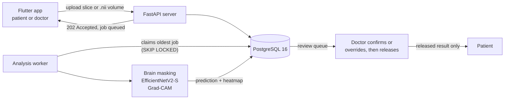
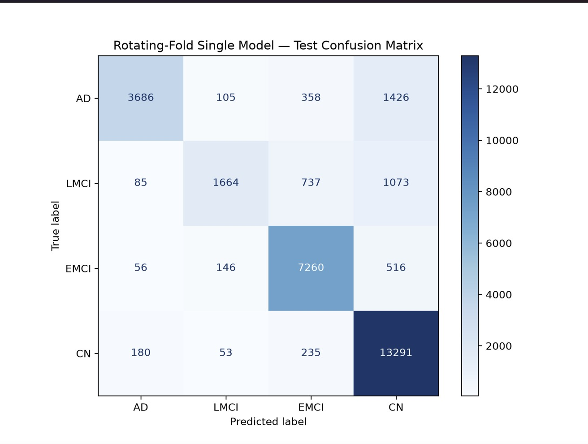
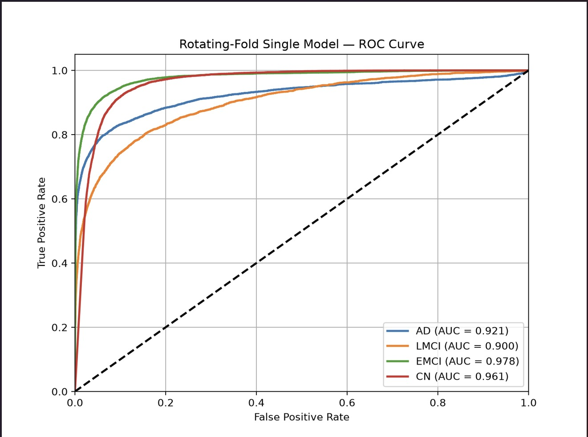
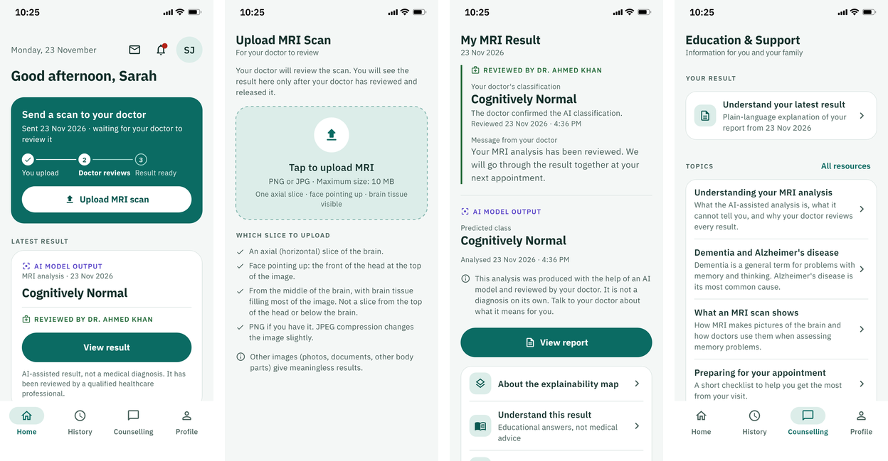
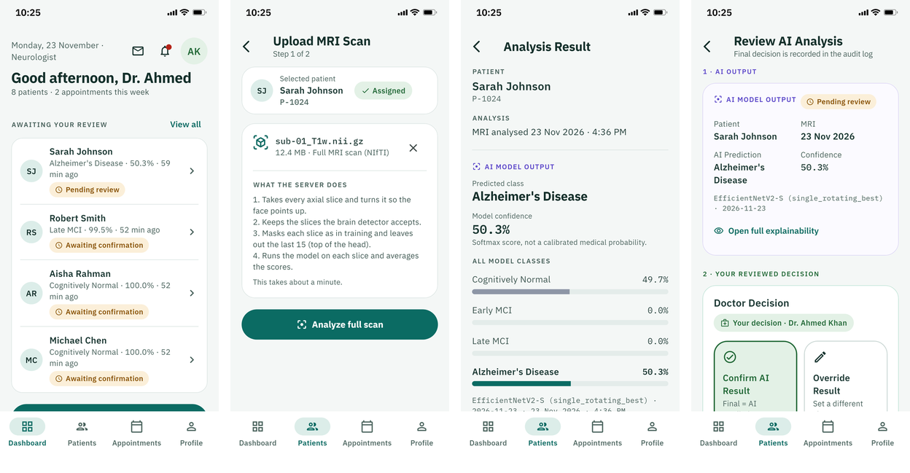

<p align="center">
  
</p>

<h1 align="center">NeuroSense</h1>

<p align="center">
  <b>Smart System for Prediction, Diagnosis and Patient Counseling of Dementia and Alzheimer's Disease</b><br>
  Senior Capstone Project, Group 25, Department of Computer Science, University of Sharjah, Fall 2026/2027
</p>

<p align="center">
  <a href="https://github.com/s3wdo/Detection-of-Dementia-Alzheimer-s/actions/workflows/backend.yml"></a>
  <a href="https://github.com/s3wdo/Detection-of-Dementia-Alzheimer-s/actions/workflows/tests.yml"></a>
  
  
  
</p>

> **Academic project. NeuroSense is not a certified medical device and must not be used to diagnose real patients.**

NeuroSense is a clinical decision support system for dementia and Alzheimer's disease. A deep learning model reads one axial T1-weighted MRI slice and sorts it into one of four groups: cognitively normal (CN), early mild cognitive impairment (EMCI), late mild cognitive impairment (LMCI) or Alzheimer's disease (AD). It also produces a Grad-CAM heatmap of where it looked. The result goes to a doctor first. The doctor reviews the prediction with the heatmap, confirms or overrides it, and releases it, and only then can the patient see it.

The NeuroSense poster won first place at AICCSA 2026, the 23rd ACS/IEEE International Conference on Computer Systems and Applications, held at the University of Sharjah in October 2026.

## Contents

- [How it works](#how-it-works)
- [Results](#results)
- [The app](#the-app)
- [Repository layout](#repository-layout)
- [Getting started](#getting-started)
- [Testing](#testing)
- [Limitations](#limitations)
- [Documentation](#documentation)
- [Team](#team)
- [Acknowledgements](#acknowledgements)

## How it works



**Model.** An ImageNet-pretrained EfficientNetV2-S, fine-tuned in PyTorch on axial slices from ADNI. The data were split by subject, so all of a person's slices are either in training or in the test set, never both. The full pipeline is in [`ml/`](ml/).

**Server.** FastAPI on Python 3.12 with PostgreSQL 16, run with Docker Compose. It has 39 endpoints and 13 tables. A background worker masks each slice, classifies it, builds the Grad-CAM map and applies a 0.80 confidence gate that flags uncertain results for careful review. Doctors can also upload a full MRI volume (`.nii` or `.nii.gz`); the server then runs the training preprocessing on every slice and averages the predictions. See [`docs/backend.md`](docs/backend.md) and [`docs/api.md`](docs/api.md).

**App.** A Flutter app with patient, doctor and administrator portals. It finds the server on the local Wi-Fi and runs on the team's iPhones through SideStore. See [`mobile/`](mobile/).

**Clinical safety rules, enforced by the server:**

- A patient never sees a result before their doctor has reviewed and released it. Until then, the server answers 404, as if the analysis did not exist.
- A doctor sees only their assigned patients. Requests for anyone else's data also get 404.
- Each analysis can be reviewed once; a second review gets 409.
- Patients see the doctor's decision and summary, never the model's probabilities or the doctor's notes.
- The AI output and the doctor's decision are stored in separate tables, so they can always be told apart.
- Uploaded images are re-encoded to strip metadata and deleted 30 days after review, and key actions are recorded in an audit log.
- Passwords are hashed with Argon2. Access tokens last 15 minutes, and refresh tokens are single-use, with the whole token family revoked if one is reused.

## Results

The final model was tested on 276 subjects, 30,871 slices, that were held out before training began.

| Metric | Value |
|:--|--:|
| Accuracy | **83.90%** |
| Macro ROC AUC (one-vs-rest) | 0.940 |
| Macro F1 | 0.783 |
| Weighted F1 | 0.829 |

| Class | Test subjects | Precision | Recall | F1 | ROC AUC |
|:--|--:|--:|--:|--:|--:|
| CN | 150 | 0.82 | 0.97 | 0.88 | 0.961 |
| EMCI | 69 | 0.85 | 0.91 | 0.88 | 0.978 |
| LMCI | 17 | 0.85 | 0.47 | 0.60 | 0.900 |
| AD | 40 | 0.92 | 0.66 | 0.77 | 0.921 |

EMCI is the class that matters most for this project. Alzheimer's disease can be slowed but not reversed, so the value of a tool like this lies in finding the disease early. The model's errors fall mostly towards CN, which is one reason every result goes to a doctor before the patient.

<p align="center">
  
  
</p>

**Why 83.90% and not 99.9%.** In an earlier progress report the model reached 99.9% on a split made by slice, where slices of the same person sat in both training and test data. A 2D network can then recognise the person instead of the disease. Under conditions like that our pipeline reached 99.9% (that progress report) and 100% (validation on subjects the final model had already trained on), at or above the best four-class ADNI result in our literature review (El-Assy et al., 99.57%). On people the model has never seen, it reaches 83.90%. That is the figure we report, and as far as we found, it is the only four-class CN, EMCI, LMCI and AD result in the reviewed literature measured on unseen subjects.

All metrics are per slice and come from one random split; the [Senior Final Report](docs/reports/Senior_Final_Report.pdf) discusses these limits in full.

## The app

<p align="center"><b>Patient portal</b>: home, upload guidance, released result, education</p>
<p align="center"></p>

<p align="center"><b>Doctor portal</b>: review queue, full-scan upload, AI result, review decision</p>
<p align="center"></p>

All names and accounts in the screenshots are fictional seed data.

## Repository layout

```
.
├── backend/            FastAPI server, analysis worker, ML inference, Alembic migrations, 95 tests
├── mobile/             Flutter app (patient, doctor and admin portals), 123 tests
├── ml/                 Data preprocessing, training script and result plots
├── junior-phase/       Junior Phase notebooks: backbone screening on OASIS and Kaggle data
├── docs/               API reference, backend guide, UML diagrams, screenshots, decisions log
├── deploy/             Caddy configuration for an optional HTTPS cloud deployment (not used in the demo)
├── .github/workflows/  CI: backend tests, app analysis and tests, Android and iOS builds
├── docker-compose.yml  Development stack (PostgreSQL 16 + API)
└── docker-compose.prod.yml
```

## Getting started

### Server

Requires Docker.

```bash
cp backend/.env.example backend/.env      # then replace every CHANGE-ME value
docker compose up -d --build
docker compose exec api python -m app.db.seed   # fictional development accounts
```

The API runs at `http://localhost:8000`, with interactive documentation at `/docs`. `GET /health` reports whether a model is loaded.

The trained model, its configuration and the brain-slice detector are included in [`backend/models/`](backend/models/), so the server loads the real model on first start. Without them it falls back to a clearly labelled stub predictor.

### App

Prebuilt builds are attached to the [latest release](https://github.com/s3wdo/Detection-of-Dementia-Alzheimer-s/releases/latest):

| File | Platform | Install |
|:--|:--|:--|
| `NeuroSense-android.apk` | Android | Open the file on the phone and allow installs from that source |
| `NeuroSense-ios.ipa` | iOS 15 or later | Open it in [SideStore](https://sidestore.io/), which signs it with your own Apple ID (installs last 7 days) |

After installing, open the server address dialog on the login screen and enter the server's address, or tap **Find server on this Wi-Fi** when the phone and the server are on the same network.

To build the app yourself (requires Flutter 3.47):

```bash
cd mobile
flutter pub get
flutter run --dart-define=API_BASE_URL=http://<server-ip>:8000/api/v1   # against a running server
flutter run --dart-define=USE_FIXTURES=true                             # demo data, no server
```

To install on an iPhone without a developer account, run the **iOS demo build (.ipa)** workflow under Actions, download the `NeuroSense-ipa` artifact and open it in SideStore.

### Model training

See [`ml/README.md`](ml/README.md). ADNI data must be requested from the [ADNI website](https://adni.loni.usc.edu/); no ADNI images or subject lists are included in this repository.

## Testing

```bash
docker compose exec api pytest -q          # backend: 95 tests against a real PostgreSQL 16
cd mobile && flutter analyze && flutter test   # app: 123 tests
```

Both suites also run on GitHub Actions on every push to `main`.

## Limitations

- The model sees one 2D slice, so the result depends on which slice is uploaded. Full-volume upload removes that choice but has so far been tested only on synthetic volumes.
- All metrics are per slice, from one random split, without confidence intervals. LMCI rests on only 17 test subjects.
- All data come from ADNI, and no external cohort has been tested.
- No clinician or patient outside the team has used the system in a structured study.
- The server runs on one laptop over plain HTTP, which is acceptable for a closed demonstration network only.

## Documentation

| Document | Contents |
|:--|:--|
| [`docs/backend.md`](docs/backend.md) | Running, testing and deploying the server; how an analysis moves through the system |
| [`docs/api.md`](docs/api.md) | Every endpoint, with request and response shapes |
| [`docs/diagrams/`](docs/diagrams/) | Use case, class, state, sequence and activity diagrams |
| [`docs/decisions-log.md`](docs/decisions-log.md) | Design decisions and the reasons for them |
| [`ml/README.md`](ml/README.md) | Data pipeline, training setup and evaluation |

### Reports

| Report | Date |
|:--|:--|
| [Senior Final Report](docs/reports/Senior_Final_Report.pdf) | November 2026 |
| [Senior Progress Report #2](docs/reports/Senior_Progress_Report_2.pdf) | October 2026 |
| [Senior Progress Report #1](docs/reports/Senior_Progress_Report_1.pdf) | September 2026 |
| [Junior Final Report](docs/reports/Junior_Final_Report.pdf) | April 2026 |

## Team

| Member | Student ID |
|:--|:--|
| Saud Muhammed Khan (project manager) | U23102335 |
| Daniel Samer Adnan Al Haj Yousef | U23102638 |
| Majed Mohammad Baygan | U23106628 |
| Becher Doueidi | U23107505 |

**Supervisors:** Prof. Saad Harous and Dr. Karam Mohamed Sallam (co-supervisor)

## Acknowledgements

Data used in this project were obtained from the Alzheimer's Disease Neuroimaging Initiative (ADNI) database ([adni.loni.usc.edu](https://adni.loni.usc.edu/)). The ADNI investigators contributed to the design and implementation of ADNI and/or provided data but did not participate in the analysis or writing of this work.

## License

Copyright © 2026 the NeuroSense team. All rights reserved. This code was written as coursework at the University of Sharjah and is shared for academic review.
