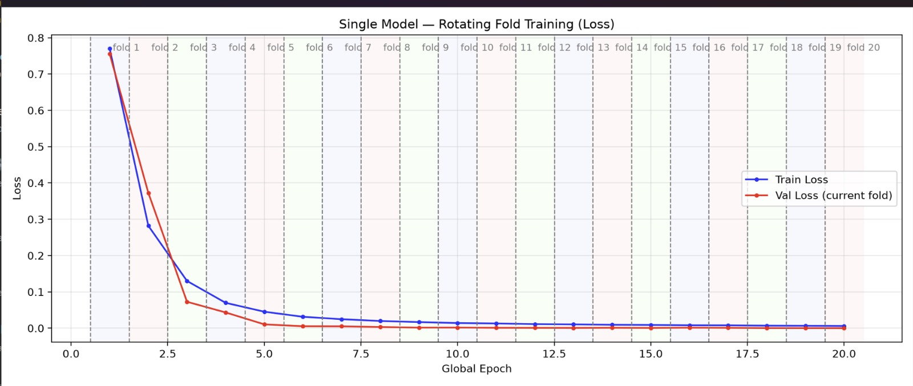
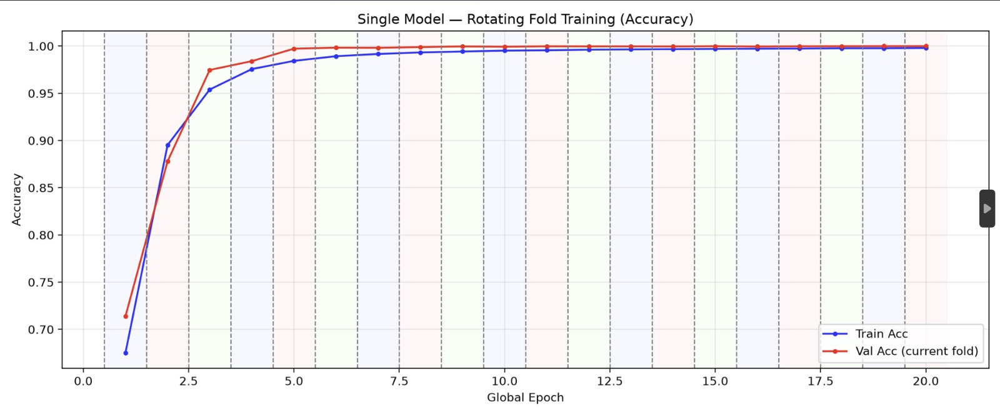
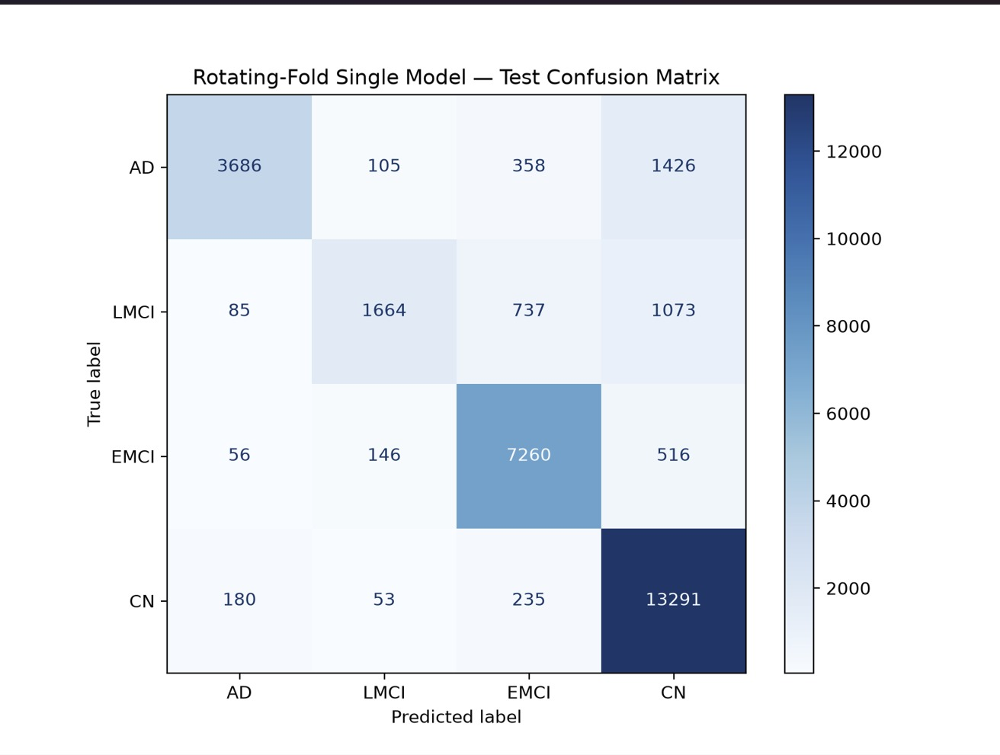
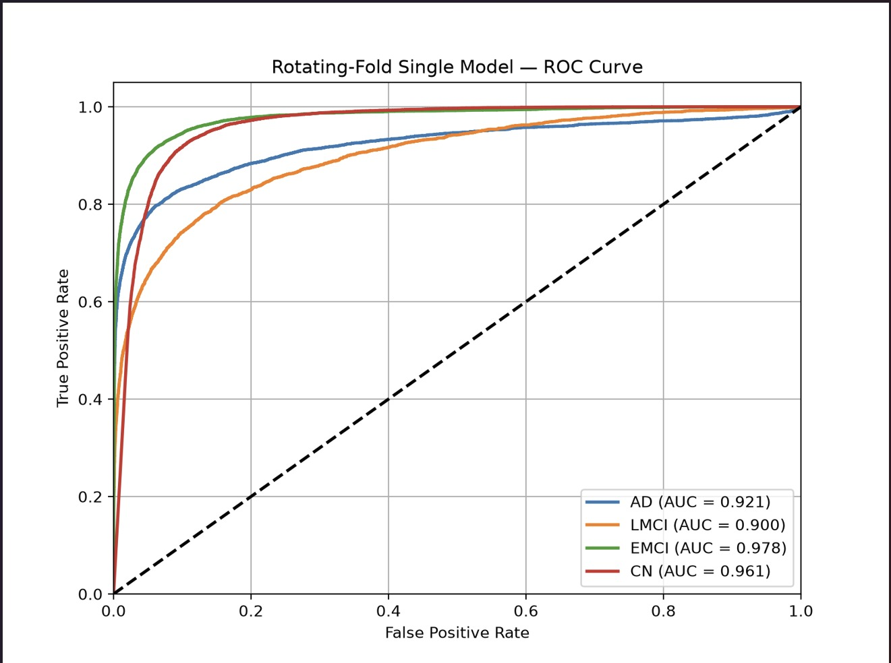
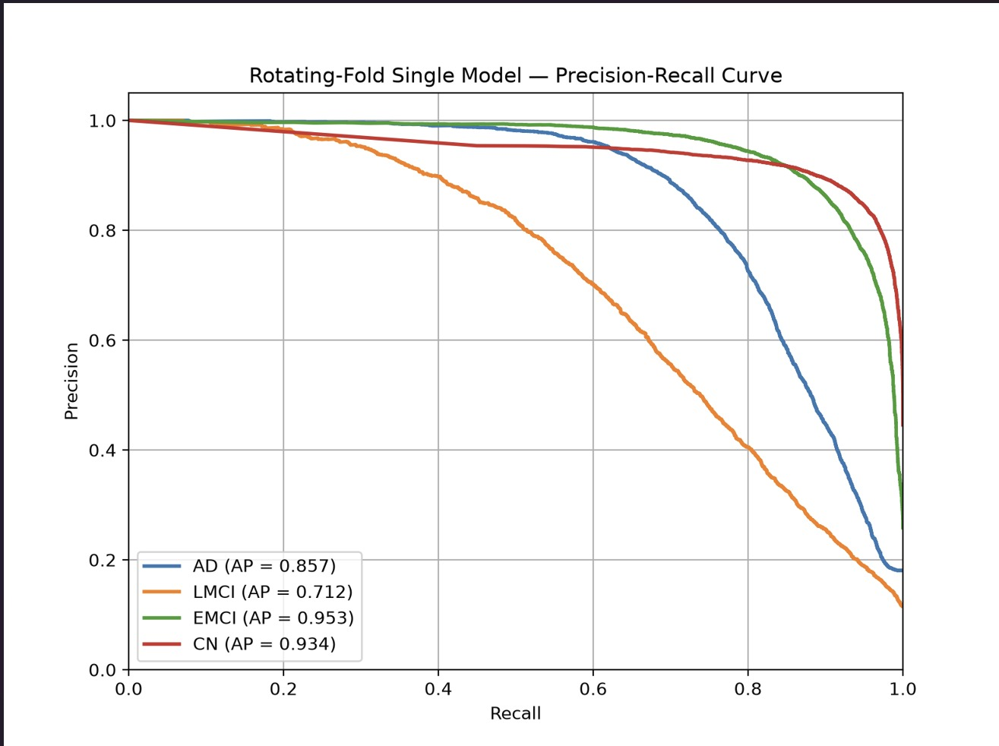

# NeuroSense model: data pipeline and training

This folder holds the code that turned ADNI MRI volumes into model-ready slices and trained the four-class EfficientNetV2-S that the server runs. The scripts are kept exactly as they were used for the results in the Senior final report, apart from line endings, one corrected comment, and the example call in `brain_slice_masking.py`, which now prunes 15 slices like the runs did. Input and output folders are set by constants at the top of each script (Windows paths from the team's machine), so edit those before running.

```
ml/
├── preprocessing/
│   ├── extract-axial.py         stage 2: NIfTI volume -> axial PNG slices
│   ├── FilterScans.py           stage 4: keep slices the brain detector accepts
│   └── brain_slice_masking.py   stage 5: prune, mask, crop and resize
├── training/
│   └── train_rotating.py        subject-level split, rotating-fold training, test evaluation
├── results/                     plots from the final run and the development runs
└── requirements.txt
```

## Data

The data come from the ADNI image collection *ADSP-PHC: ADNI T1 1.0* (T1-weighted MRI). Each subject keeps one diagnostic group across visits, and the four groups are used as the classes:

| Class | Meaning | Scans | Slices |
|:--|:--|--:|--:|
| CN | Cognitively normal | 2,430 | 136,442 |
| EMCI | Early mild cognitive impairment | 1,412 | 81,705 |
| LMCI | Late mild cognitive impairment | 739 | 42,449 |
| AD | Alzheimer's disease | 668 | 37,055 |
| **Total** | | **5,249** | **297,651** |

ADNI data cannot be redistributed. To reproduce the work, apply for access at [adni.loni.usc.edu](https://adni.loni.usc.edu/) and download the collection yourself. The training script expects one folder per class (`AD`, `LMCI`, `EMCI`, `CN`), with ADNI's download hierarchy kept underneath: subject, image series, visit date, image ID, then the slices.

## Preprocessing

| Stage | Script | What it does |
|:--|:--|:--|
| 1. Unpack | manual | Extract the ADNI archives in their original folder structure; volumes that fail to load are skipped |
| 2. Axial extraction | `extract-axial.py` | Reorient each volume to RAS with nibabel and save every axial slice as an 8-bit PNG, scaled by its own min and max |
| 3. Rotation | not kept | Rotate each slice by 90° so the front of the head faces the top of the image |
| 4. Brain-slice filtering | `FilterScans.py` | Score each slice with a binary EfficientNetV2-S brain detector and keep it only if the "not brain" score is below 0.4 |
| 5. Prune, mask, crop | `brain_slice_masking.py` | Drop the 15 most superior slices of each scan, then mask out everything outside the brain (Otsu threshold at 0.45×, largest component, convex hull, erosion), crop with 8 px padding and resize to 224 × 224 with area interpolation |
| 6. Normalise | `train_rotating.py` | Three-channel tensor with ImageNet mean and standard deviation |

The script used for stage 3 was not kept, and the brain detector (`EfficientNetV2S_brain_detector.keras`) is not in this repository. The server repeats stages 2 to 6 for full-volume uploads, in `backend/app/ml/`.

We used axial slices because they show the largest cross-section of the brain per slice. Masking was added after Grad-CAM showed that an early model was responding to bright regions outside the brain, which depend on the scanner rather than the disease.

## Training

`train_rotating.py` does the following:

1. Groups every slice by its subject folder and holds out 10% of subjects as the test set (`train_test_split`, seed 42). The test slice paths are written to `test_patients_paths.csv` so the split can be audited.
2. Splits the remaining subjects into 20 folds (`KFold`, seed 123). One model trains for one epoch per fold, rotating through the folds, for 20 epochs, with early stopping at a patience of 12.
3. Fine-tunes torchvision's ImageNet-pretrained `efficientnet_v2_s` with a new `Linear(1280, 4)` head. All layers are trained.
4. Evaluates the best checkpoint on the held-out subjects and saves the metrics, the confusion matrix and the ROC and precision-recall curves.

| Setting | Value |
|:--|:--|
| Class order | AD, LMCI, EMCI, CN |
| Optimiser | Adam, learning rate 1e-5 |
| Scheduler | ReduceLROnPlateau (factor 0.5, patience 2) |
| Loss | Cross-entropy with class weights 1.2, 1.4, 1.0, 0.85 |
| Batch size | 20 |
| Hardware | NVIDIA RTX 5070 (8 GB), 32 GB RAM |
| Training time | 10 h 10 min |

A note on validation: after the first epoch, every validation fold holds subjects the model has already trained on, so validation accuracy reaches 100%. Only the held-out test set measures performance on new people.

```bash
pip install -r requirements.txt
python training/train_rotating.py
```

## Results

Held-out test set: 276 subjects, 30,871 slices.

| Class | Subjects | Precision | Recall | F1 | Specificity | ROC AUC | AP |
|:--|--:|--:|--:|--:|--:|--:|--:|
| AD | 40 | 0.92 | 0.66 | 0.77 | 0.987 | 0.921 | 0.857 |
| LMCI | 17 | 0.85 | 0.47 | 0.60 | 0.989 | 0.900 | 0.712 |
| EMCI | 69 | 0.85 | 0.91 | 0.88 | 0.942 | 0.978 | 0.953 |
| CN | 150 | 0.82 | 0.97 | 0.88 | 0.824 | 0.961 | 0.934 |

Accuracy 83.90% (25,901 of 30,871 slices), macro ROC AUC 0.940, macro F1 0.783, weighted F1 0.829.

| Training loss | Training accuracy |
|:--:|:--:|
|  |  |

| Confusion matrix | ROC curves | Precision-recall curves |
|:--:|:--:|:--:|
|  |  |  |

`results/development_backbone_confusion_matrices.png` compares EfficientNetV2-S with ResNet, Xception, InceptionV3 and EfficientNetV2-M from the development runs. EfficientNetV2-S was the strongest, and LMCI was the hardest class for all five.

All metrics are per slice and come from one random split. The development runs that chose masking, pruning and the backbone also used the final test subjects, so the test figures may carry some optimistic bias.

## Serving the model

Save the trained weights as `backend/models/model.pt` and put this `model_config.yaml` next to it:

```yaml
name: EfficientNetV2-S (single_rotating_best)
version: 2026-11-23
architecture: efficientnet_v2_s_linear   # weights-only file with a single Linear(1280, 4) head
input_size: 224
channels: 3
resize_interpolation: area
scale: 0.00392156862
mean: [0.485, 0.456, 0.406]
std: [0.229, 0.224, 0.225]
classes:
  - AD
  - LMCI
  - EMCI
  - CN
output: logits
masking: brain_v1
explain: gradcam
```

For full-volume uploads, also copy the brain detector to `backend/models/brain_detector.keras`.
